<div align="center">

# Talaash

**A lost-child desk for crowded venues: malls, airports, stadiums, festivals.**
AI agents run the search. A person approves every call that matters.

[**Live app**](https://talaash-live-app.alternatefutures.ai) ·
[**Demo video (2:46)**](https://drive.google.com/file/d/1xorVHMRTbd0yjJyrXn6qA5ZYee8apY4P/view?usp=sharing) ·
Built for **Agentika 2.0 at NaSCon’26**, theme *Human + AI: Better Together* ·
Deployed on **Alternate Clouds** (Clouds by Alternate Futures)

<br>

<a href="https://drive.google.com/file/d/1xorVHMRTbd0yjJyrXn6qA5ZYee8apY4P/view?usp=sharing" title="Watch the Talaash demo on Google Drive">
  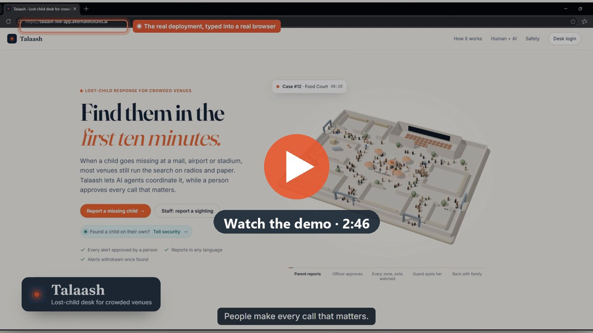
</a>

<sub>Click to watch the 2:46 demo on Google Drive. Everything in it was recorded on the live deployment and the real Discord server.</sub>

</div>

---

## Contents

1. [The problem](#the-problem)
2. [What Talaash does](#what-talaash-does)
3. [Where the human comes in](#where-the-human-comes-in)
4. [Try it as a judge](#try-it-as-a-judge)
5. [System architecture](#system-architecture)
6. [How a search runs](#how-a-search-runs)
7. [The agents](#the-agents)
8. [Features](#features)
9. [Fake reports and misuse](#fake-reports-and-misuse)
10. [Reliability](#reliability)
11. [Data model](#data-model)
12. [API and pages](#api-and-pages)
13. [Deployment on Alternate Clouds](#deployment-on-alternate-clouds)
14. [Run it locally](#run-it-locally)
15. [Project structure](#project-structure)
16. [Limits and what’s next](#limits-and-whats-next)
17. [Team and credits](#team-and-credits)

---

## The problem

When a child goes missing in a big venue, the first minutes matter most. Most venues still run that search on radios and paper: a guard writes down a description and reads it over the radio, nobody tracks which zones were searched, and widening the search or calling the police depends on someone remembering the procedure under pressure. Once the child is found, their name and description stay in messages and on screens.

Talaash is for **venue security teams** (the desk officer and guards) and the **parents** who come to them. The venue is the customer. It relates to UN **SDG 16.2** (protecting children) and **SDG 11.7** (safe public spaces).

<p align="center">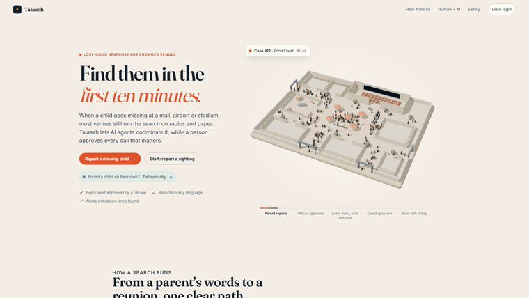</p>

## What Talaash does

| Who | What they get |
|---|---|
| **Parent** | Reports from their phone in their own words, any language, by **voice** or text, with an optional photo. A private **status page** then shows the search progress, with no details anyone could misuse. |
| **Desk officer** | A live desk: queue, case detail with what the AI extracted and what it doubts, escalation clock, **3D venue map**, sightings with confidence scores, PA announcements, notes, incident reports and stats. |
| **Guards** | Alerts in Discord, a sighting form, and a **guard assistant** in `#guard-chat` they can talk to in plain words. |
| **A stranger who finds a child** | A “found a child” page. Staff are sent to them, and the child is matched against parents’ reports. |
| **Any MCP client** | An **MCP server** at `/mcp` exposing the same tools the guard assistant has. |

<table>
<tr>
<td width="25%">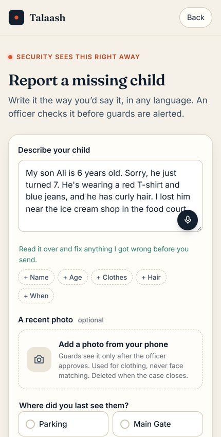</td>
<td>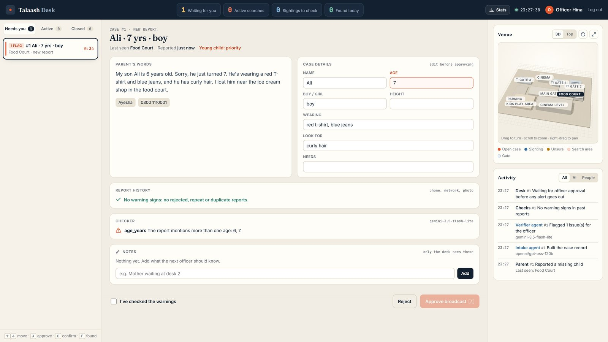</td>
</tr>
<tr>
<td><sub>A parent speaks; Whisper writes it down and they check it before sending.</sub></td>
<td><sub>At the desk: the case Intake built, and the Verifier flagging “two different ages: 6, 7” because the parent corrected themselves.</sub></td>
</tr>
</table>

## Where the human comes in

Full autonomy is the wrong goal when a child’s safety is at stake. AI does the fast, tedious work; **people make the calls that carry risk**:

| Step | Who decides | Why a person |
|---|---|---|
| **Broadcast a report** | Desk officer approves | Stops prank reports, and stops someone in a custody dispute using guards to track a child. Approve stays locked until the warnings are checked. |
| **Act on a sighting** | Desk officer confirms | Anything scored below 75% goes to a person, never straight to action. The officer confirms even “likely” sightings. |
| **Hand a found child over** | Desk officer, after a three-part identity check | Stops someone claiming a child who isn’t theirs. |
| **Close the case** | Desk officer | Only a person can say a child is safe. Closing withdraws every alert and deletes the photo. |
| **Announce on the PA** | Desk officer approves the AI draft | The AI never uses the child’s name; a stranger could call the child over with it. |

The AI side **has no way to approve, confirm, reunite or close anything**: the guard assistant and the MCP server simply don’t have those tools, and a test checks this.

## Try it as a judge

| | |
|---|---|
| **Live app** | https://talaash-live-app.alternatefutures.ai |
| **Desk login** | `/login` · username **`desk`** · password **`nascon-desk`** (a demo account; any name works in “Your name”) |
| **No login needed** | `/report` (parent, works on a phone) · `/found` (found a child) · `/sighting` (staff) |

A quick run, about 3 minutes:

1. On a phone, open **/report**, pick a zone and describe a child (or tap the mic and say it).
2. On a laptop, log in to **/desk**: review what the AI extracted and flagged, then **Approve broadcast**.
3. Watch the escalation clock: in the demo deployment it widens to every zone after **1 minute** and calls the police after **2**.
4. Open **/sighting** and describe a similar child in another zone. The desk shows the match score; **Confirm sighting**.
5. Press **Child found, close case**. The parent’s page shows “Found” and an incident report is written.

## System architecture

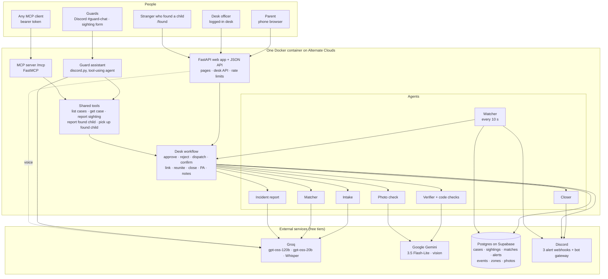

**How the pieces fit**

- **One container, one process.** FastAPI serves the pages and API. The Watcher and the Discord bot run as background threads in the same process; slow follow-up work (matching, Discord clean-up, incident reports) runs in short-lived threads, so the officer gets an answer immediately. No queues or extra workers, so there is less to break during a live demo.
- **Postgres holds everything**, including an **audit log** (`events`) of every agent decision and human action. The desk polls `/api/desk` every 3 seconds; the parent’s status page polls every 4.
- **Every state change is atomic** (`UPDATE … WHERE status = … RETURNING`), so two officers pressing the same button, or a guard and the officer acting at once, can’t double-approve, double-close or confirm a sighting on a closed case.
- **Alerts go through Discord webhooks**, stand-ins for a venue’s radio or staff messaging. All sending lives in `notify.py`, so another channel can be swapped in.
- **Two doors for outside agents, same tools:** the guard assistant and the MCP server both call `tools.py`. Neither can approve, reject, reunite or close.

## How a search runs

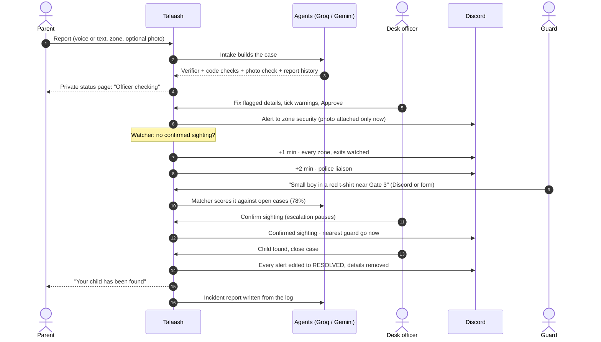

A case moves through these states (found children use the same table with `kind = found`):

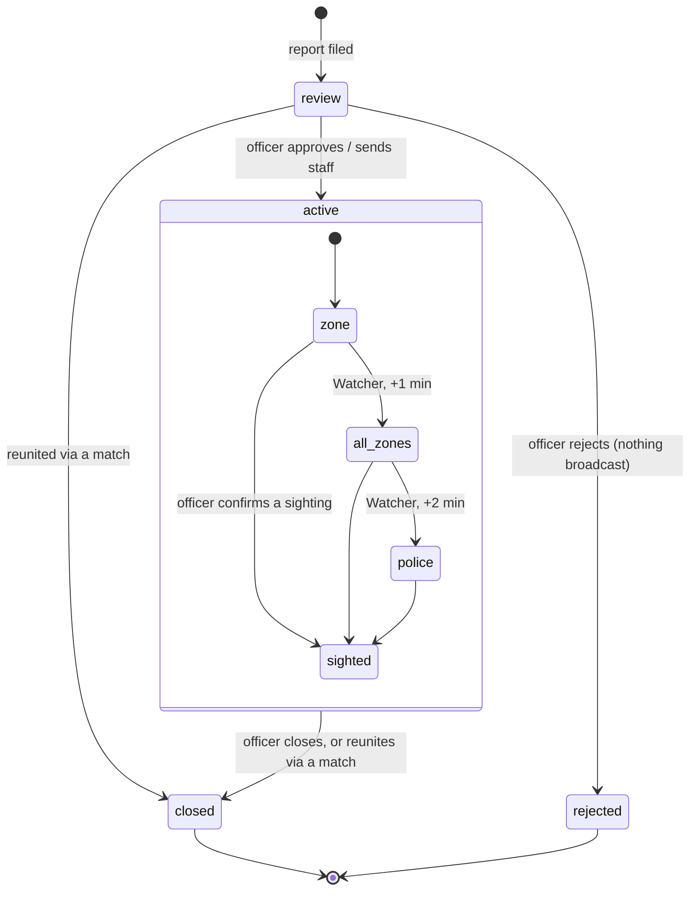

## The agents

| Agent | Runs on | Job |
|---|---|---|
| **Intake** | Groq `openai/gpt-oss-120b`, falls back to `gpt-oss-20b` | Reads the report in any language and fills only what was said: name, age, boy/girl, clothing, features, last seen, needs. Unknowns stay empty, never guessed. |
| **Verifier** | Gemini `3.5 Flash-Lite` (a **different model family**), falls back to Qwen on Groq, then to code checks only | Checks every field against the parent’s exact words and quotes the evidence. Flags jokes and tests, adults, contradictions and custody red flags. Plain-code checks catch two different ages (“6 years… he just turned 7”) and missing clothing. |
| **Photo check** | Gemini vision | Reads **clothing, hair and carried items only, never faces.** Flags photos with no child, drawings or screenshots, several people, and photos that contradict the words. |
| **Report checks** | Plain code, no model | Warning signs no model can see: rejected or repeat reports from the same phone, duplicates of open cases, bursts across the venue, many reports from one network, reused photos (perceptual hash), and a bot trap. |
| **Matcher** | Groq `gpt-oss-120b` | Scores each guard sighting against open cases with reasons. **≥ 75%** = likely (officer confirms), **45–75%** = human review queue, below = no match. Also matches **found children against parents’ reports, in both directions.** |
| **Watcher** | Plain code, every 10 s | Widens the alert to every zone, then escalates to police, unless a sighting was confirmed. Timings come from `ESCALATION_MINUTES`. |
| **Closer** | Plain code | When a person closes, edits every Discord alert to RESOLVED, strips the photo, deletes it and settles open sightings. |
| **PA drafter** | Groq `gpt-oss-120b` + code checks | Drafts a calm announcement **without the child’s name or any phone number**; checked in code, with a template fallback. Found children get a deliberately vague announcement. |
| **Incident report** | Code, phrased by Groq | Timings worked out from the log; the AI only rephrases them, and a summary containing any number not in the facts is thrown away. |
| **Guard assistant** | Groq with tool calling, in Discord | Guards ask “what are we looking for near gate 2?”, describe a child they see, report a lost child they’re holding, or say “I have the child from case 3”. It remembers each guard’s last few messages. It has no approve or close tool. |

<table>
<tr>
<td width="50%">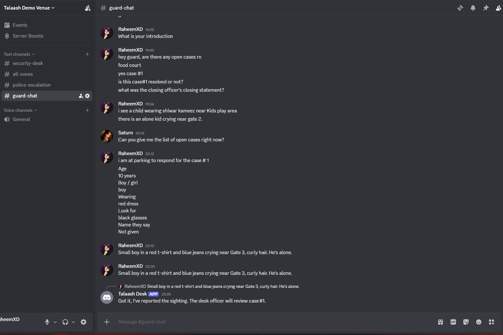</td>
<td>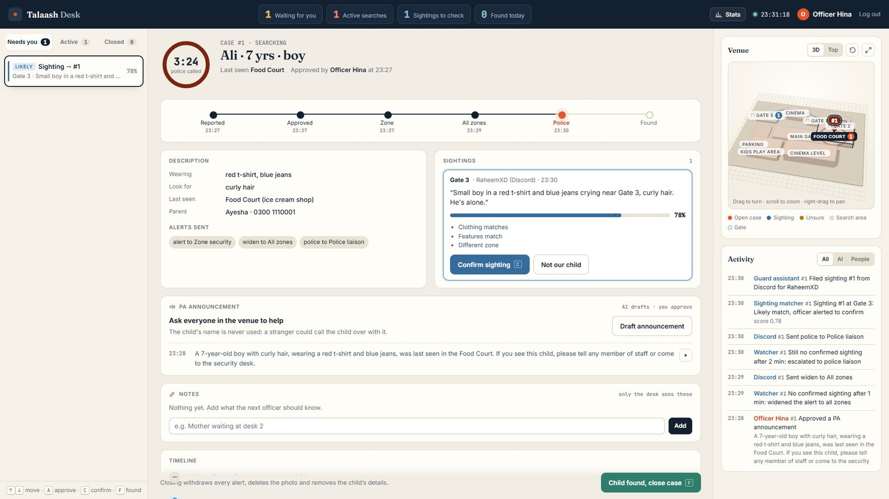</td>
</tr>
<tr>
<td><sub>A guard describes a child in <code>#guard-chat</code>; the assistant files the sighting.</sub></td>
<td><sub>The desk shows it as a 78% likely match. The officer confirms.</sub></td>
</tr>
</table>

## Features

**For parents**
- Report by **voice** (Groq Whisper, any language) or text; they read the transcript before sending. Very short or silent recordings and Whisper’s known phantom phrases are rejected.
- Optional **photo**: shrunk on the phone, location data stripped, re-encoded on the server, shown to guards **only after approval**, deleted on close.
- A private, unguessable **status page** that updates itself: checking → guards searching → every zone → police → found.

**For the desk officer**
- Queue with **Needs you / Active / Closed** tabs, live counts, notifications for new reports, and keyboard shortcuts (↑ ↓, A, C, F).
- Case review with the parent’s words, flagged phrases highlighted, editable fields, report history and checker results.
- **Escalation clock** ring and stage stepper per case.
- **3D venue map** (Three.js): case pins, sighting dots with links to their case, the search area shaded. In the bigger view the officer can **add, move, resize, rename or remove zones**; forms, the guard assistant and the MCP server pick up changes straight away.
- **PA announcements**: the AI drafts, the officer edits and approves, the browser reads it aloud, and it’s logged. At most one every 2 minutes per case.
- **Private notes** that only the desk sees (never sent to guard tools or MCP).
- **Incident report** on close (timings, a time bar, a summary, Print) and a **stats** panel: reports, children found, median time to find, median officer response, false reports stopped, reunions.

**Found children**
- `/found` for anyone holding a lost child. The officer **sends staff**; the post says where to go but **never describes the child**.
- A guard marks **“staff have the child”** (in Discord or on the desk), so the finder’s page tells them they can go.
- **Two-way matching** with parents’ reports, or a manual link if the matcher missed it, then a side-by-side comparison and a **three-part identity check** before reuniting.

<table>
<tr>
<td>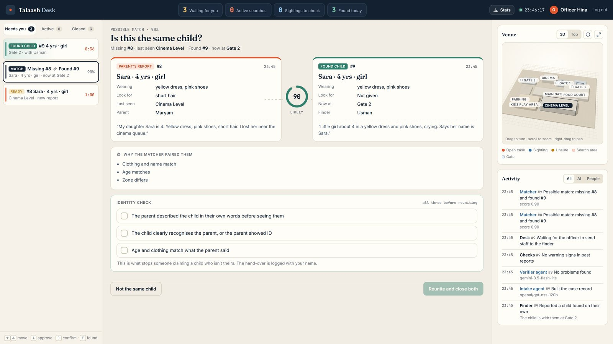</td>
<td width="25%">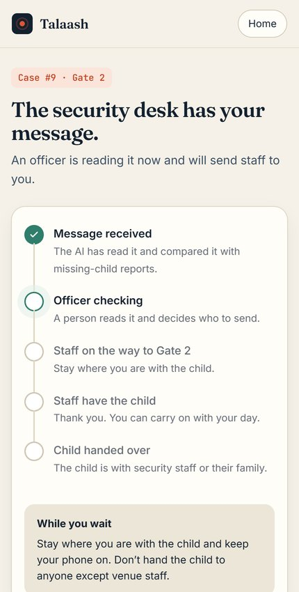</td>
</tr>
<tr>
<td><sub>A stranger’s report matched to the mother’s at 90%. Reuniting stays locked until all three identity checks are ticked.</sub></td>
<td><sub>The finder’s own status page.</sub></td>
</tr>
</table>

## Fake reports and misuse

No system can prove a report is false, so Talaash doesn’t pretend to. It puts the warning signs in front of the officer and keeps the decision with a person.

| Layer | What it does |
|---|---|
| Officer approval | Nothing reaches guards, Discord or the PA until a person approves. |
| Verifier | Flags jokes, tests, adults, contradictions and custody red flags in the report. |
| Report history | Rejected or repeat reports from the same phone, likely duplicates, bursts of reports, many reports from one network. |
| Photo checks | No child in the photo, not a real photo, photo vs words, the same photo reused in another report. |
| Acknowledgement | Approve stays locked until the officer ticks “I’ve checked the warnings and spoken to the reporter”. |
| Found-child claims | Found children are never described in public; reuniting needs a three-part identity check and is logged with the officer’s name. |
| Rate limits and bot trap | Per-network limits on every public form and on voice: a warning sign first (venue Wi-Fi is shared), a hard block later. A hidden field only bots fill in. IP addresses are never stored, only a keyed hash. |
| Privacy | Agents never see contact details, notes, photos or found-child locations. Details are removed from every alert on close. |

## Reliability

- **Key rotation:** five Groq and five Gemini keys rotate; a rate-limited key rests and the next one is used.
- **Time budgets and fallbacks:** every model call has a time limit. If every model is down, the case is still created and handed to the officer to fill in by hand, sightings go to the review queue, and the Watcher (plain code) keeps escalating.
- **Atomic state changes** guard against double clicks and races between officers and guards.
- **Discord** sends retry on rate limits and every failure is logged in `alerts`.
- **Tests:** 25 offline tests (`pytest`) run in GitHub Actions before every image build. They cover model outages, fallbacks, key rotation, sighting routing, PA safety checks, the incident summary’s number guard, photo cleaning and reuse detection, rate limits, and the rule that outside agents can’t approve or close.

## Data model

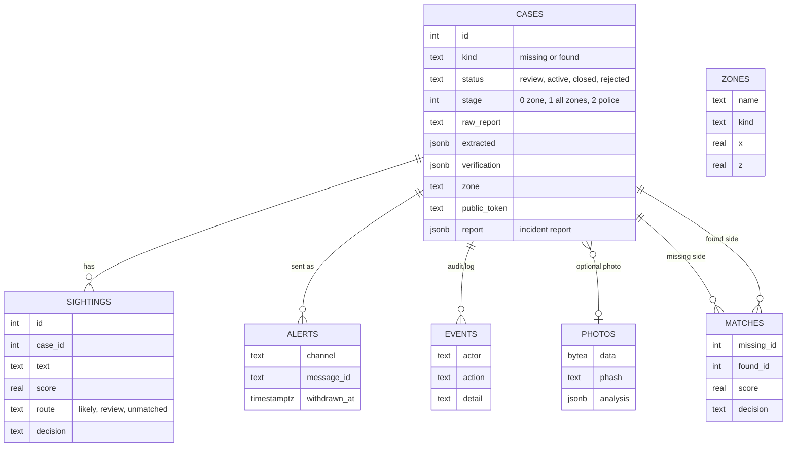

## API and pages

| Route | Who | What |
|---|---|---|
| `GET /` | Public | Landing page with the 3D venue scene |
| `GET/POST /report` | Public | Parent report (text, voice, photo) |
| `GET/POST /found` | Public | Report a found child |
| `GET/POST /sighting` | Staff | Report a sighting |
| `GET /status/{token}` · `GET /api/status/{token}` | Parent or finder | Private progress page |
| `POST /api/transcribe` | Public, rate limited | Voice → text (Whisper) |
| `GET /login` · `GET /desk` · `GET /api/desk` | Officer | Desk and its live data |
| `POST /api/cases/{id}/approve · reject · dispatch · collect · close · notes` | Officer | Case decisions |
| `POST /api/cases/{id}/pa/draft · pa/approve` | Officer | PA announcements |
| `POST /api/sightings/{id}/confirmed · dismissed` | Officer | Sighting decisions |
| `POST /api/matches/link · {id}/reunite · {id}/dismiss` | Officer | Found-child matching |
| `GET /api/photos/{id}` · `GET /api/stats` | Officer | Photo and stats |
| `POST · PATCH · DELETE /api/zones` | Officer | Edit the venue map |
| `/mcp` | MCP client with bearer token | `list_zones`, `list_open_cases`, `get_case`, `report_sighting`, `report_found_child` |
| `GET /healthz` | Anyone | Database and configuration check |

## Deployment on Alternate Clouds

Talaash runs as one Docker container on **Alternate Clouds** (service `talaash-live`, 1 CPU, 1 GB, pay as you go), at **https://talaash-live-app.alternatefutures.ai**.

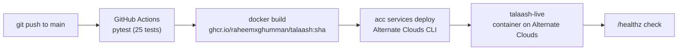

```text
$ acc services deploy talaash-live --image ghcr.io/raheemxghumman/talaash:<sha> --cpu 1 --memory 1Gi --spend payg -y
  ✓ Creating deployment transaction (1/7)
  ✓ Waiting for provider bids (2/7)
  ✓ Selecting best bid (3/7)
  ✓ Creating lease with provider (4/7)
  ✓ Sending deployment manifest (5/7)
  ✓ Container starting up (6/7)
  ✓ Deployment is live (7/7)
✅ Success! Deployment is live!
```

Configuration is set as service environment variables with `acc services env set`; no secrets are in this repository.

## Run it locally

Requirements: Python 3.12+, a Postgres database (Supabase free tier works), and free Groq and Gemini API keys. Discord is optional.

```bash
git clone https://github.com/raheemxghumman/talaash
cd talaash
python -m venv .venv
.venv/Scripts/pip install -r requirements.txt     # macOS/Linux: .venv/bin/pip
cp .env.example .env                              # fill it in (see below)
.venv/Scripts/python -m uvicorn app.main:app --reload
```

| Variable | What it is |
|---|---|
| `GROQ_API_KEYS`, `GEMINI_API_KEYS` | Comma-separated keys; they rotate. |
| `GEMINI_MODELS` | Gemini models in order of preference. |
| `DATABASE_URL` | Postgres connection string. Tables are created on start. |
| `DISCORD_WEBHOOK_DESK`, `_ALL_ZONES`, `_POLICE` | Alert channels. Leave empty to skip Discord. |
| `DESK_USER`, `DESK_PASSWORD` | Desk login. |
| `MCP_TOKEN` | Bearer token for `/mcp`. |
| `DISCORD_BOT_TOKEN`, `DISCORD_AGENT_CHANNEL_ID`, `DISCORD_BOT_ENABLED=1` | The guard assistant (enable it on one instance only). |
| `ESCALATION_MINUTES` | Watcher steps, e.g. `30,60` in a venue; the demo uses `1,2`. |

Useful commands:

```bash
.venv/Scripts/python -m pytest -q                 # 25 offline tests
.venv/Scripts/python scripts/reset_demo.py --yes  # wipe all cases before a demo
```

## Project structure

```text
app/
  main.py         routes, desk login, uploads, voice, rate limits, /mcp mount
  desk.py         the workflow: cases, found children, matching, reunite, PA, Watcher, incident reports, stats
  agents.py       Intake, Verifier, Matcher, PA drafter and summary prompts + code checks
  llm.py          Groq, Gemini, Gemini vision and Whisper calls with key rotation and fallbacks
  photos.py       photo cleaning, perceptual hash, clothing-only analysis
  abuse.py        per-network rate limits (hashed, never raw IPs)
  notify.py       Discord sends, photo attachments, the Closer's withdrawals
  tools.py        the shared tools outside agents may use
  guard_bot.py    the Discord guard assistant (tool calling, short memory)
  mcp_server.py   MCP server with bearer auth
  venue.py        editable venue zones
  db.py           schema and connection pool
  templates/      pages: landing, report, found, sighting, status, login, desk
  static/         desk.js, venuemap.js (3D map), venue3d.js (landing scene), CSS
tests/            25 offline tests, run in CI
scripts/          reset_demo.py
docs/             README images
.github/workflows/image.yml   test → build → push to ghcr.io
```

## Limits and what’s next

Honest about what this is: a working, deployed system tested with demo data, not yet with a real venue.

- **Not built yet:** connecting to a venue’s own radio and PA system (the PA plays from the desk computer), SMS or WhatsApp updates for parents, staff accounts with roles, and several venues per installation. There is one demo desk account.
- **By design, not built:** face recognition or CCTV scanning. Sightings come from people, and photos are read for clothing only.
- **Discord** stands in for a venue’s staff messaging; `notify.py` is the single place to swap in another channel.
- The demo escalation timings (1 and 2 minutes) are deliberately short; a venue would set its own.

## Team and credits

**404 Team Not Found**: Abdul Raheem and Wania Rahman. Agentika 2.0, NaSCon’26.

Built with FastAPI, psycopg, httpx, Jinja2, Pillow, discord.py, the MCP Python SDK and Three.js; fonts Fraunces, Inter and JetBrains Mono. AI models from Groq (gpt-oss, Whisper, Qwen) and Google (Gemini). Hosted on Alternate Clouds; database on Supabase. The demo video was edited with HyperFrames and GSAP, with narration by Microsoft Edge neural text-to-speech.
